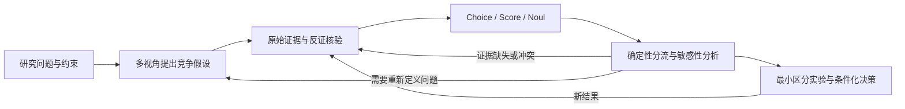

# Research Duo

**多视角探索 × 类型化决策 × 实验反馈**

Research Duo 是可安装的科研探索与决策 skill。它将 [Pantheon](https://www.k-dense.ai/blog/introducing-pantheon-80-voices) 的多元视角方法，与 [TypeSafe Jev](https://docs.typesafe.ai/introduction) 的原子化类型判断结合，把研究问题推进到证据、取舍和下一步实验。

这是方法与工作流蒸馏，不是模型权重蒸馏。独立项目，非 K-Dense 或 TypeSafe 官方产品。

## 如何协作



| 模块 | 实际能力 |
| --- | --- |
| 探索 | 80 个原创思维视角目录，通常按需选择 8–16 个 |
| 证据 | 竞争假设、反证、原文定位、同源证据去重、少数意见 |
| 判断 | 可选真实 Jev HTTP 客户端，或明确标记的普通模型推理 |
| 决策 | 证据/风险/校准分流，硬约束过滤，权重敏感性 |
| 反馈 | 实验卡、决策日志、二元 Brier / ECE / 覆盖率评估 |

**核心 skill 无需 API key。** 没有调用真实 Jev 时会明确说明；多视角不被当作独立实验，角色共识也不被当作正确率。

## 安装

Python 工具只需 Python 3.10+ 标准库。以下在仓库根目录执行：

```bash
git clone https://github.com/YUAILUN/Research-Duo.git
cd Research-Duo
python3 scripts/install_skill.py
```

默认安装到 `$CODEX_HOME/skills/research-duo`，未设置 CODEX_HOME 时为 `~/.codex/skills/research-duo`。已有安装不会被覆盖；更新时请先保存自定义修改，再显式指定 `--replace`。如宿主未即时发现，重开会话。

其他兼容 Agent Skills 的工具：将 `skills/research-duo` 整个目录复制到该工具的 skills 目录。各宿主工具调用能力有所不同。

## 使用

```text
使用 $research-duo：我想评估研究方向 A 与 B。
目标是三个月内形成可验证的机制证据，预算 5 万元。
先用 8 个视角提出竞争假设，再核验原始证据。
给出有条件的优先级、最小区分实验和改变结论的条件。
```

也可用于文献争议、实验路线选择、基金选题与多学科资源取舍。入口：[SKILL.md](skills/research-duo/SKILL.md)；完整演示：[合成研究案例](examples/research-walkthrough.md)。

## 运行工具

```bash
# 默认 dry-run：不联网、不消耗 API 额度
python3 skills/research-duo/scripts/jev_client.py skills/research-duo/assets/jev-request.json

# 确定性工具：均不调用模型、不执行建议
python3 skills/research-duo/scripts/decision_tools.py gate skills/research-duo/assets/gate-example.json
python3 skills/research-duo/scripts/decision_tools.py rank skills/research-duo/assets/ranking-example.json
python3 skills/research-duo/scripts/decision_tools.py calibrate skills/research-duo/assets/calibration-example.json
```

真实 Jev 调用：在本机配置 `TYPESAFE_API_KEY` 后，给客户端增加 `--execute --out jev-result.json`。它会发送请求中的材料到 TypeSafe，并可能产生费用。密钥不得提交到 GitHub。默认示例为无个人数据的合成材料。细节见 [接入说明](skills/research-duo/references/jev.md)。

gate 示例故意设置了高概率却与证据冲突的情形，预期路线为 `deliberate`，不会因为高置信度直接推荐。所有示例数字均为合成，不是 Jev 实测结果或科研发现。

## 验证与边界

```bash
python3 -m unittest discover -s tests -v
python3 scripts/check_package.py
```

测试覆盖请求/响应契约、错误返回、限流重试、低质量证据分流、校准不匹配、硬约束、排序敏感性及二元评价。测试使用 mock 与合成数据，**不等于真实 Jev 服务连通性或领域准确率验证**。

- Jev 的 confidence 是分布统计量，不直接等于结论正确率。
- 未做领域留出验证的数值不能被包装成经过验证的可靠性。
- 排序是透明偏好模型；示例权重与阈值不是科学标准。
- 引文存在与引文支持主张是两项不同检查。
- 工具只提供研究建议；实验实施等后续行为遵守实际授权与专业要求。

## 项目结构与共同开发

```text
skills/research-duo/
  SKILL.md               技能入口
  agents/openai.yaml     展示信息
  references/            80 视角、证据、决策、Jev 与来源
  assets/                研究模板与合成输入
  scripts/               Jev 客户端、确定性工具
examples/                完整演示
tests/                   离线行为测试
scripts/                 安装与打包检查
```

贡献指南：[CONTRIBUTING.md](CONTRIBUTING.md)。修改方法时同步来源、边界、示例；修改计算时增加能捕捉实际错误的测试。不要提交真实研究隐私、密钥或未经授权的第三方全文。

MIT License。原创视角与流程未复制 mimeographs 的人格文本；引用和设计归属见 [sources.md](skills/research-duo/references/sources.md)。
