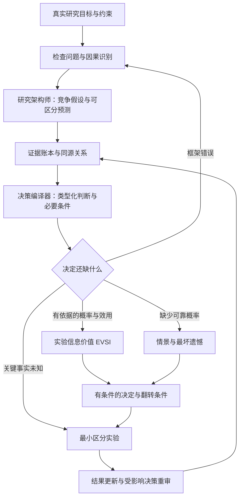

# Research Duo

**让多视角探索落到可识别的研究、可区分的实验和可复核的决定。**

## 项目共同贡献者

- [YUAILUN](https://github.com/YUAILUN)
- [hudancqmu-cyber](https://github.com/hudancqmu-cyber)

本名单由项目发起人指定，用于项目署名；GitHub 侧栏的 Contributors 按提交记录自动统计。

Research Duo 是兼容 **Claude Code、Codex、Google Antigravity** 的科研 skill。它把 [Pantheon 的多视角探索](https://www.k-dense.ai/blog/introducing-pantheon-80-voices)与 [Jev 的原子判断、类型约束和显式组合思想](https://docs.typesafe.ai/introduction)融入一个闭环，并针对 [Fusion Intelligence](https://github.com/YUAILUN/Fusion-Intelligence) 已有的证据与审议能力增加可执行的决策分析。

**不调用 Jev，不需要 TypeSafe API key。** 科研推理由所在平台的模型完成；Python 脚本只做本地验证和计算。这里的“蒸馏”是方法与工作流，不是训练模型或复制 RLCD。独立项目，非 K-Dense 或 TypeSafe 官方产品。

## 两项职责，一个科研闭环



“研究架构师”和“决策编译器”是职责，不要求两个模型或并行代理。默认按需选 3–6 个功能视角，80 视角目录用于查找缺口。没有工具时仍可完成方法分析；可用 Python 时给可重复的数字。

| 能力 | 实际交付 |
| --- | --- |
| 问题重构 | 区分机制、因果、预测、测量与资源决策，先排除不可识别或终点错位 |
| 假设竞争 | 假设 × 不同预测 × 区分实验，找出能让方案翻转的关键条件 |
| 原子判断 | choice / ordinal / predicate；证据、假设、未知与冲突显式分开 |
| 证据追踪 | 证据 → 主张 → 判断 → 决定；检测循环、悬空引用，追踪更新影响 |
| 选择下一步 | EVSI/EVPI、无概率情景的 minimax regret / maximin、偏好权重敏感性 |
| 结果学习 | 对照事前预测定位错误；形成有适用范围、反例和失效触发器的经验卡 |

这些机制针对“更好的科研决策”设计。**目前没有经盲评证明整体优于 Pantheon 或 Fusion Intelligence。** [差异说明](docs/comparison.md)区分已有能力与本版增加的能力；[评估方案](evals/README.md)用于实际验证，不能用测试数量或流程长度替代结论。

## 安装到三个平台

需要 Git；可选计算与安装脚本需要 Python 3.9+，无 pip 依赖。

```bash
git clone https://github.com/YUAILUN/Research-Duo.git
cd Research-Duo
python3 scripts/install_skill.py --target all
```

| 平台 | 默认个人安装目录 | 调用 |
| --- | --- | --- |
| Codex | `~/.agents/skills/research-duo` | `$research-duo` 或技能选择器 |
| Claude Code | `~/.claude/skills/research-duo` | `/research-duo` |
| Antigravity App / 当前 IDE | `~/.gemini/config/skills/research-duo` | App 中 `/research-duo`；IDE 中指定使用 Research Duo |

按官方文档于 **2026-10-17** 核查目录：[Codex](https://learn.chatgpt.com/docs/build-skills)、[Claude Code](https://code.claude.com/docs/en/skills)、[Antigravity](https://antigravity.google/docs/skills)。技能使用标准 `SKILL.md` 与相对资源路径，未绑定平台专用工具。格式/安装兼容已验证；尚未完成三个宿主各自运行完整科研任务的端到端实测。

单个平台、项目级或旧版路径：

```bash
python3 scripts/install_skill.py --target claude
python3 scripts/install_skill.py --target all --project /absolute/path/to/existing-project
python3 scripts/install_skill.py --target antigravity-legacy
python3 scripts/install_skill.py --target antigravity-cli
python3 scripts/install_skill.py --target codex-legacy
```

项目级 all 复制到 `.claude/skills` 与共享的 `.agents/skills`；Antigravity 旧 IDE 选项为 `~/.gemini/antigravity/skills`，CLI 选项为 `~/.gemini/antigravity-cli/skills`。`codex-legacy` 用于仍读 `~/.codex/skills` 的旧环境；自定义 CODEX_HOME 可用 `--destination /your/path/skills/research-duo`。只选择当前宿主需要的路径，避免同名副本同时被发现。

更新：`git pull --ff-only` 后给安装命令增加 `--replace`。旧版会备份到 skills 目录之外的 `skill-backups`，防止备份被误识别成另一个技能。需要保留的本地定制可从备份合并。初版曾含 Jev 客户端，本版替换安装会移除该接口；旧目录副本应迁出技能扫描路径。安装后重开会话或刷新技能列表。

不能运行安装器时，手动把 `skills/research-duo` 整个目录复制到相应位置即可。

## 直接开始

```text
使用 Research Duo，深度分析以下科研设计：
研究问题：[我的问题与已有数据]
目标：[希望得到的机制证据或需要作出的决定]
资源：[预算、时间、样本与设备约束]

先检查问题是否可识别，提出竞争假设和可区分预测，
找出能让方案翻转的关键条件，设计最小区分实验。
有可靠概率才算信息价值，否则用情景分析。
交付可执行的下一步、证据依据及继续/停止/转向规则。
```

Codex 可把首句替换为 `使用 $research-duo`；Claude Code 使用 `/research-duo`。支持 quick、design/deep、update；不用同时启用所有计算。入口：[SKILL.md](skills/research-duo/SKILL.md)；[完整合成演示](examples/research-walkthrough.md)；[护理研究设计合成案例](examples/nursing-research-design.md)；[输入模板](skills/research-duo/assets/research-brief.md)。

## 本地计算

```bash
python3 skills/research-duo/scripts/decision_tools.py gate skills/research-duo/assets/gate-example.json
python3 skills/research-duo/scripts/decision_tools.py audit skills/research-duo/assets/evidence-graph-example.json
python3 skills/research-duo/scripts/decision_tools.py voi skills/research-duo/assets/voi-example.json
python3 skills/research-duo/scripts/decision_tools.py robust skills/research-duo/assets/robust-example.json
python3 skills/research-duo/scripts/decision_tools.py rank skills/research-duo/assets/ranking-example.json
python3 skills/research-duo/scripts/decision_tools.py calibrate skills/research-duo/assets/calibration-example.json
```

输入、公式与限制见 [决策协议](skills/research-duo/references/decision-protocol.md)。示例全为合成资料/假设数字，不是模型实测或科研发现。无事实依据的概率不会因进入脚本就变可靠，效用分数也不是成功概率。

## 验证与共同开发

```bash
python3 -m unittest discover -s tests -v
python3 scripts/check_package.py
```

自动检查覆盖原子契约、必要条件、未知/冲突路由、EVSI 边界、遗憾计算、证据更新、安装备份与独立目录运行。GitHub Actions 在推送/PR 时执行。详情见 [验证记录](evals/validation.md)。

科研判断的质量需要真实任务和独立评估；本地测试只证明相关软件行为。完整任务的文献检索、模型费用与数据处理仍由宿主平台提供。技能不会自动训练模型、保存隐私数据或执行实验。

共同开发参见 [CONTRIBUTING.md](CONTRIBUTING.md)。MIT License。来源与设计归属见 [sources.md](skills/research-duo/references/sources.md)。
